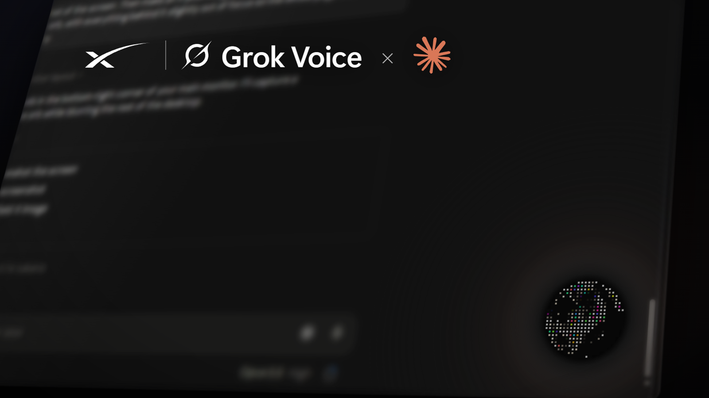
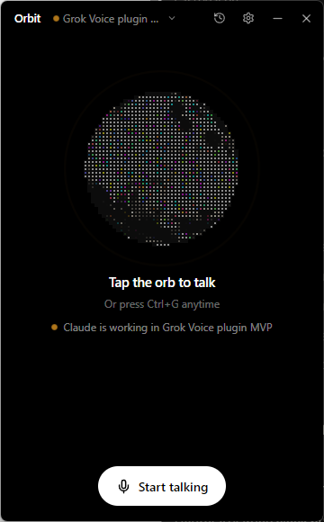

<p align="center"></p>

<h1 align="center"> Orbit</h1>

<p align="center"><b>A hands-free voice companion for Claude Code Desktop, powered by Grok Voice.</b><br>
Ask what Claude is doing, hear when it finishes, switch sessions, and dictate prompts, without touching the keyboard.</p>

<p align="center"><a href="../../releases/latest"><b>Download for Windows</b></a> · <a href="#how-it-works">How it works</a> · <a href="SECURITY.md">Security</a></p>

<p align="center"></p>

> Orbit is an independent open-source project. It is not affiliated with, endorsed by, or sponsored by xAI or Anthropic. Grok is a trademark of xAI; Claude is a trademark of Anthropic.

---

## What it does

- **Talk to your sessions.** "What's Claude doing?", "Did it finish?", "Summarize my launchpad session." Orbit reads your Claude Code sessions from disk and Grok answers out loud.
- **Hear when Claude is done.** Orbit watches your recent sessions and plays a chime, shows a Windows notification, and (optionally) has Grok tell you what Claude did.
- **Dictate prompts, safely.** "Tell Claude to run the tests." Grok drafts it and reads it back. It only types into Claude's prompt box after you say **yes**. You can edit the draft first.
- **Switch sessions by voice or click.** "Switch to my Ladder 6 session." Orbit opens it in Claude's sidebar, without moving your mouse.
- **Stays out of the way.** Minimize it to a small always-on-top orb. The orb changes with Grok's state (listening, thinking, talking). It has no glow around it: brightness alone says how active it is. It dims when asleep and brightens with Claude-orange tiles flowing through it while Claude is working. It can also pulse very slightly with your voice (optional).
- **Stick to Claude Code (optional).** The orb rides on the Claude window:
  - It follows the window as you move or resize it, at any display scaling.
  - It stays on top of Claude without floating over other apps.
  - It hides while Claude is minimized.
  - Drag it to choose its spot on the window.
- **You control the mic, and the bill.** Say "go to sleep" and Orbit hangs up, so nothing is billed while it sleeps. Or use **one question at a time** mode: press the hotkey (default **Ctrl+Alt+G**, changeable), ask, and it hangs up after answering.
- **Say "Hey Grok" (optional).** A free, fully offline wake word starts Grok again after it has gone to sleep. It's recognized on your PC by a small speech model, so no audio leaves your computer until Grok is awake. Each wake starts a fresh conversation: Grok doesn't remember the previous one, but it can always re-read your Claude sessions.
- **Mute your mic in other apps while Grok listens (optional).**
  - While Grok has your mic, the apps you choose (Discord, Zoom, Teams…) get silence, so you don't have to mute yourself there.
  - Pick "mute all apps except…" or "mute only…", then switch apps on or off from the list of apps using your mic.
  - Recording and audio-routing apps (OBS, Voicemeeter, Krisp…) are left alone unless you switch them on.
  - They get your mic back the moment Grok sleeps. Orbit only unmutes what it muted, even after a crash.
- **Copy to clipboard.** "Copy Claude's last answer", "copy that command": Grok puts it on your clipboard, ready to paste.
- **A second brain for hard questions.** When a question needs more thought, or needs a look at the code in your current project ("why would the hotkey stop working after sleep?"), Grok quietly asks Claude and tells you the answer.
  - Grok picks Haiku, Sonnet or Opus to fit the question.
  - Claude can read your project but can't change anything.
  - Nothing shows up on screen. You choose the model and connection in Settings → Second brain.

## Requirements

- Windows 10 or 11 (x64)
- [Claude desktop app](https://claude.ai/download) with Claude Code sessions
- An [xAI API key](https://console.x.ai). Voice is billed by xAI per minute connected (about $0.08/min at the time of writing). Orbit shows an estimate in Settings → Usage. Saying "go to sleep" hangs up, so sleeping costs nothing.
- For the second brain: Claude Code, signed in. The Claude desktop app already includes it, and Orbit finds it automatically. Questions count toward your Claude plan, or toward an Anthropic API key if you set one in Settings.

## Install

1. Download `Orbit-Setup-x.y.z.exe` from the [latest release](../../releases/latest).
2. Run it. The installer isn't code-signed yet, so Windows SmartScreen may warn you. Click **More info → Run anyway**. You can check the download against the `.sha256` file on the release page.
3. Paste your xAI key when Orbit asks. It's encrypted with your Windows account (DPAPI) and never leaves your PC except to talk to xAI.
4. Click the orb or press **Ctrl+Alt+G** and start talking.

## Using it

| Say or do | What happens |
| --- | --- |
| "What's Claude doing right now?" | Grok reads the open session and summarizes it |
| "List my sessions" / "What happened in the shakeout session?" | Finds and reads other sessions |
| "Switch to the launchpad dashboard" | Opens that session in Claude |
| "Tell Claude: add a dark mode toggle" | Shows a draft, reads it back, waits for your "yes" |
| "Go to sleep" | Grok says goodbye and Orbit hangs up (nothing billed) |
| "Hey Grok" / the hotkey / click the orb | Starts a fresh conversation (turn the wake word on in Settings → Listening) |
| "Copy Claude's last answer" / "Copy that" | Puts it on your clipboard |
| "What went wrong?" | Grok reads Orbit's recent error log and explains |
| "How does the wake word avoid false triggers in this project?" / "Is this approach sound?" | Grok asks Claude (the second brain) and answers in its own words |
| Title bar → session name | Pick a session to open it, or ask Grok about it |
| Title bar → clock icon | Conversation history (this run only, never saved) |
| Title bar → gear | Voice, speed, listening mode, notifications, second brain, hotkey, start with Windows, stick to Claude Code, usage |
| Floating orb | Click: open · drag: move · right-click: sleep/wake |

## How it works

```
 Orbit (Electron)
   ├── main window + floating orb (React; orb is orbkit SHDR-29)
   └── local bridge on 127.0.0.1:4317 (inside the app)
         ├── Grok Voice realtime API   wss://api.x.ai/v1/realtime  (your key)
         ├── reads sessions            Claude's session list + ~/.claude/projects/**/*.jsonl  (read-only)
         ├── watches for "finished"    stat()s recent transcripts every 2 s
         ├── fills / sends / switches  Windows UI Automation on the Claude window (no keystrokes, no clipboard)
         └── second brain              your Claude Code, headless (claude -p): read-only, isolated, nothing saved
```

- Claude's **Microsoft Store** version keeps its session list in `%LOCALAPPDATA%\Packages\Claude_*\LocalCache\Roaming\Claude`. The regular installer uses `%APPDATA%\Claude`. Orbit checks both.
- **Sending a prompt** fills Claude's prompt box through Windows accessibility and presses Claude's own Send button. There are no key presses, focus changes or clipboard use. It refuses if the box already has your own typing, if a different session is open than the one the draft was for, or if it can't confirm the text landed.
- **Switching sessions** presses the session's sidebar button through accessibility, and confirms the window title changed.
- **The wake word** uses [Vosk](https://alphacephei.com/vosk/) (small English model, ~40 MB, shipped with the installer) running in a hidden helper page. "Grok" isn't in that model's vocabulary, so Orbit listens for close matches ("hey rock", "hey brock") and gives the model decoy names ("Brooke", "Rob", "Bob", "Rocky"...) so similar names don't trigger it. In testing it caught 10 of 10 "Hey Grok" clips across 9 voices and ignored 12 of 13 sound-alikes. The one miss was someone actually saying "Hey Brock".
- **The second brain** runs your own Claude Code in its official headless mode (`claude -p`). Grok calls it as a tool, choosing the model and either "think" (no tools) or "explore" (read-only Read, Glob and Grep in the project of the Claude session that's open). Each run is isolated:
  - none of your Claude Code settings, hooks, plugins or MCP servers
  - no Bash or edit tools
  - `.env` files and keys denied
  - nothing saved to your session history

  It's capped at 1, 2.5 or 5 minutes for Haiku, Sonnet or Opus, and stops if you hang up.
- **Stick to Claude Code** runs a small helper that listens for Windows' own events: the Claude window moving, being minimized or changing virtual desktop, and another app coming to the front.
  - The helper moves the orb itself the instant Claude moves, so the orb doesn't trail behind a dragged window. In a simulated drag it stayed in place for 39 of 40 steps.
  - It works in real pixels on every display (per-monitor DPI aware), and keeps the orb a fixed distance from the window's corner, in Orbit's own units, at any resolution or scaling.
  - It uses under 1% of one CPU core while idle.
  - The orb is topmost while Claude or Orbit is in front. Otherwise it sits directly above Claude in the window stack, so other apps cover both.
  - If Claude is closed or on another virtual desktop, the orb floats freely as usual.
- **Muting other apps' mics** works through Windows Core Audio: each app's microphone stream can be muted on its own.
  - While Grok listens, Orbit mutes the mic streams of the apps your rules allow, never its own, and checks every second for new ones.
  - Apps are matched by program file (for example `discord.exe`).
  - Recording and audio-routing apps are left alone by default. Muting a router such as Voicemeeter, Krisp or NVIDIA Broadcast would silence everything that uses its virtual mic, Orbit included.
  - Afterwards it unmutes only the streams it muted.
  - The apps' own mute buttons are untouched; they just receive silence.
  - What it muted is written to `%APPDATA%\Orbit\mic-steal.state`. If Orbit is closed or crashes, the helper unmutes on its way out, and the next launch undoes anything left over.
- Settings, usage and logs live in `%APPDATA%\Orbit`.

## Privacy and terms of use

- Orbit is a **voice input method** for you, like dictation. Every prompt is yours, shown to you, and sent only after you confirm. Grok can't send on its own. The app enforces this in code: a voice "send" only goes through if your transcribed reply after the draft is a clear yes. Please don't modify Orbit to send prompts automatically or run Claude unattended through its UI. For automation, use Claude Code's official headless mode (`claude -p`) or the Agent SDK.
- The parts of your sessions Grok reads are sent to **xAI** to answer you. Don't use Orbit on sessions containing secrets you wouldn't share with xAI.
- When Grok uses the second brain, the question goes to **Anthropic** through your Claude Code, along with the recent messages of your open session and any project files Claude reads. Claude's answer then goes to xAI so Grok can say it. Turn the second brain, or just "Read the current project", off in Settings if you don't want that.
- Nothing else leaves your computer. There's no telemetry and no auto-update. Logs never contain keys or prompt text.
- The wake word listens only on your PC, only while it's turned on and Grok is off or asleep. Its audio is never recorded or sent anywhere.

## Build from source

Requires Node.js 20+ on Windows.

```bash
npm ci
npm run build:ui
npm run app
```

`npm run dist` builds the installer into `dist/`. `npm run web` runs the same UI in a browser tab (no floating orb or hotkey). `npm run check` reads your sessions without needing a key.

Project layout: `electron/` window shell, tray and hotkey · `src/` local bridge, Grok tools, session reader and watcher, Windows automation script · `ui/` React UI.

## Security

See [SECURITY.md](SECURITY.md) for the threat model, what Orbit does to protect you, the published security review, and how to report a vulnerability.

## License

[MIT](LICENSE). Third-party components are listed in [THIRD_PARTY_NOTICES.md](THIRD_PARTY_NOTICES.md).
