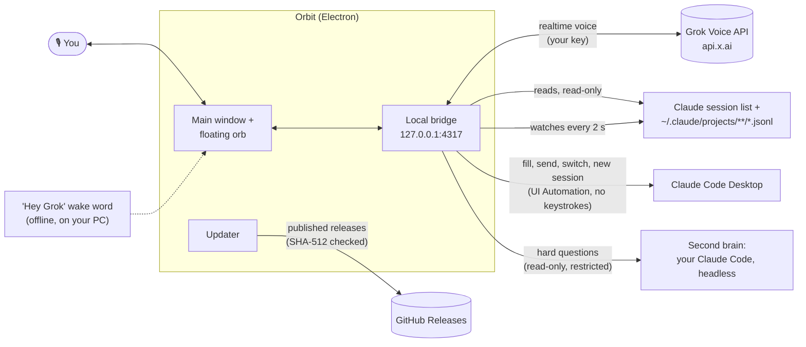

<p align="center"><a href="docs/demo.mp4"></a></p>

<h1 align="center"> Orbit</h1>

<p align="center"><b>A hands-free voice companion for Claude Code Desktop, powered by Grok Voice.</b><br>
Ask what Claude is doing, hear when it finishes, switch sessions, and dictate prompts, without touching the keyboard.</p>

<p align="center">
  <a href="../../releases/latest"></a>
  
  <a href="LICENSE"></a>
  <a href="SECURITY.md"></a>
</p>

<p align="center"><a href="../../releases/latest"><b>⬇ Download for Windows</b></a> · <a href="docs/demo.mp4">Watch the demo (MP4)</a> · <a href="#how-it-works">How it works</a> · <a href="SECURITY.md">Security</a></p>

<p align="center"></p>

> Orbit is an independent open-source project. It is not affiliated with, endorsed by, or sponsored by xAI or Anthropic. Grok is a trademark of xAI; Claude is a trademark of Anthropic.

---

## What it does

- **Talk to your sessions.** "What's Claude doing?", "Did it finish?", "Summarize my launchpad session." Orbit reads your Claude Code sessions from disk and Grok answers out loud.
- **Hear when Claude is done.** Orbit watches your recent sessions and plays a chime, shows a Windows notification, and (optionally) has Grok tell you what Claude did.
  - **Even while Grok sleeps (optional).** With "Wake Grok to say it" on (Settings → When Claude finishes, off by default), Grok connects just long enough to say what Claude finished and asks what you'd like to do. The mic opens only after Grok has spoken, for 3 seconds. Answer and the conversation carries on; stay quiet and it hangs up. There's no always-on listening. Each wake bills a few seconds of xAI time. Press the hotkey or click the orb to hang up a wake at once.
  - **When something you asked for is ready.** With "Wake Grok when something you asked for is ready" (on by default with "Grok tells me"), Grok also wakes when Claude finishes a prompt it sent for you, or when the second brain answers after you hung up. At most 6 wakes an hour, at least 30 s apart.
- **Picks up where you left off.** Hanging up used to start the next call from scratch. Now, for 30 minutes, the next call gets a short note from Orbit: the last few things said, the session that was open, and what you're still waiting on. Grok uses it only when you refer back ("where were we?", "what did Claude say?"). It's kept in memory only, never on disk, and a draft in it is never sent without a new read-back and a fresh yes.
- **Start a new session by voice.** "Start a new session", "new thread in castpilot". Orbit presses Claude's own New session button, then Grok asks what you want to say and drafts it as usual. You never touch the keyboard.
- **Dictate prompts, safely.** "Tell Claude to run the tests." Grok drafts it and reads it back. It only types into Claude's prompt box after you say **yes**. Want it worded differently? Just say so and Grok redrafts it. It's all by voice: there's no card or button to click.
- **Switch sessions by voice or click.** "Switch to my Ladder 6 session." Orbit opens it in Claude's sidebar, without moving your mouse.
- **Stays out of the way.** Minimize it to a small always-on-top orb. The orb changes with Grok's state (listening, thinking, talking). It has no glow around it: brightness alone says how active it is. It dims when asleep. While Claude is working and Grok is off, it brightens with Claude-orange tiles flowing through it. While Grok is on, it keeps Grok's colors. It can also pulse slightly with your voice and/or Grok's, by an amount you choose (optional).
- **Stick to Claude Code (optional).** The orb rides on the Claude window:
  - It follows the window as you move or resize it, at any display scaling.
  - It stays on top of Claude without floating over other apps.
  - It hides while Claude is minimized.
  - Drag it to choose its spot on the window.
- **You control the mic, and the bill.** Say "go to sleep" and Orbit hangs up, so nothing is billed while it sleeps. Or use **one question at a time** mode: press the hotkey (default **Ctrl+Alt+G**, changeable), ask, and it hangs up after answering.
- **Say "Hey Grok" (optional).** A free, fully offline wake word starts Grok again after it has gone to sleep. It's recognized on your PC by a small speech model, so no audio leaves your computer until Grok is awake. Each wake starts a fresh connection, with Orbit's short note on the last call (see above), and Grok can always re-read your Claude sessions.
- **Copy to clipboard.** "Copy Claude's last answer", "copy that command": Grok puts it on your clipboard, ready to paste.
- **A second brain for hard questions.** When a question needs more thought, or needs a look at the code in your current project ("why would the hotkey stop working after sleep?"), Grok quietly asks Claude and tells you the answer.
  - Grok picks Haiku, Sonnet or Opus to fit the question.
  - Claude can read your project but can't change anything.
  - Its answer comes back shaped for voice: a short spoken answer, with details and file references kept for follow-up questions. If Claude suggests a prompt to act on it, Grok offers to send it, and drafts it only if you say yes.
  - Hang up while it's thinking, and the answer still reaches you: Grok wakes to tell you, or tells you in your next call.
  - Nothing shows up on screen. You choose the model and connection in Settings → Second brain.

## Requirements

- Windows 10 or 11 (x64)
- [Claude desktop app](https://claude.ai/download) with Claude Code sessions
- An [xAI API key](https://console.x.ai). Voice is billed by xAI per minute connected (about $0.08/min at the time of writing). Orbit shows an estimate in Settings → Usage. Saying "go to sleep" hangs up, so sleeping costs nothing (unless you turn on "Wake Grok to say it": each spoken update bills a few seconds).
- For the second brain: Claude Code, signed in. The Claude desktop app already includes it, and Orbit finds it automatically. Questions count toward your Claude plan, or toward an Anthropic API key if you set one in Settings.
  - Claude Code keeps its own sign-in, separate from the Claude desktop app's, and it can expire even while the desktop app still works. Orbit checks it (Settings → Second brain shows "Signed in ✓" or a **Sign in** button). If a question fails because the sign-in expired, Grok tells you and offers to open the sign-in: say yes, and Claude Code's own sign-in opens in a small window and your browser.

## Install

1. Download `Orbit-Setup-x.y.z.exe` from the [latest release](../../releases/latest).
2. Run it. The installer isn't code-signed yet, so Windows SmartScreen may warn you. Click **More info → Run anyway**. You can check the download against the `.sha256` file on the release page.
3. Paste your xAI key when Orbit asks. It's encrypted with your Windows account (DPAPI) and never leaves your PC except to talk to xAI.
4. Click the orb or press **Ctrl+Alt+G** and start talking.

## Using it

| Say or do | What happens |
| --- | --- |
| "What's Claude doing right now?" | Grok reads the open session and summarizes it |
| "List my sessions" / "What happened in the shakeout session?" | Finds and reads other sessions |
| "Switch to the launchpad dashboard" | Opens that session in Claude |
| "Start a new session" / "New thread in castpilot" | Opens a new, empty Claude session, then asks what to tell Claude |
| "Tell Claude: add a dark mode toggle" | Shows a draft, reads it back, waits for your "yes" |
| "Go to sleep" | Grok says goodbye and Orbit hangs up (nothing billed) |
| "Hey Grok" / the hotkey / click the orb | Starts a fresh conversation (turn the wake word on in Settings → Listening) |
| "Copy Claude's last answer" / "Copy that" | Puts it on your clipboard |
| "What went wrong?" | Grok reads Orbit's recent error log and explains |
| "How does the wake word avoid false triggers in this project?" / "Is this approach sound?" | Grok asks Claude (the second brain) and answers in its own words |
| Title bar → session name | Pick a session to open it, or ask Grok about it |
| Title bar → clock icon | Conversation history (this run only, never saved) |
| Title bar → gear | Voice, speed, listening mode, notifications, second brain, hotkey, start with Windows, stick to Claude Code, usage |
| Floating orb | Click: open · drag: move · right-click: sleep/wake |

## How it works



- Claude's **Microsoft Store** version keeps its session list in `%LOCALAPPDATA%\Packages\Claude_*\LocalCache\Roaming\Claude`. The regular installer uses `%APPDATA%\Claude`. Orbit checks both.
- **Sending a prompt** fills Claude's prompt box through Windows accessibility and presses Claude's own Send button. There are no key presses, focus changes or clipboard use. It goes into the one Claude window showing the session the draft was for, and refuses if no window or two windows show it, if the box already has your own typing, or if it can't confirm the text landed. The session is checked again just before Send is pressed.
- **Several Claude windows** (sessions popped out into windows of their own, or more than one main window): Orbit works in the one you were in last, the same one the orb sits on. Grok's "current session" is that window's session.
- **Switching sessions** brings forward the Claude window the session is already open in. Otherwise it presses the session's sidebar button through accessibility and confirms the window title changed. Bringing a window forward is the one focus change Orbit makes, and only when you ask to switch.
- **Starting a new session** presses Claude's own **New** button in its sidebar (or **New session in *folder*** when you name a project), and confirms an empty new-session page appeared. Nothing is typed. Claude creates the session when you send the first prompt, which goes through the usual draft and "yes". That send checks the new, still-empty session is still the one open. Reading it back waits a few seconds for Claude to save it to disk, and never reads a different session in its place.
- **Spoken updates while asleep** connect only when Claude finishes and the setting is on. The bridge itself drops all mic audio until Grok's update has been spoken and the window has opened, forwards it for about 3 seconds, and hangs up if you didn't speak. The window's page doesn't even open the microphone before then. Only speech that's transcribed into words carries on (a cough doesn't), and a conversation started this way hangs up after 20 seconds of quiet.
- **The wake word** uses [Vosk](https://alphacephei.com/vosk/) (small English model, ~40 MB, shipped with the installer) running in a hidden helper page. "Grok" isn't in that model's vocabulary, so Orbit listens for close matches ("hey rock", "hey brock") and gives the model decoy names ("Brooke", "Rob", "Bob", "Rocky"...) so similar names don't trigger it. In testing it caught 10 of 10 "Hey Grok" clips across 9 voices and ignored 12 of 13 sound-alikes. The one miss was someone actually saying "Hey Brock".
- **The second brain** runs your own Claude Code in its official headless mode (`claude -p`). Grok calls it as a tool, choosing the model and either "think" (no tools) or "explore" (read-only Read, Glob and Grep in the project of the Claude session that's open). Each run is isolated:
  - none of your Claude Code settings, hooks, plugins or MCP servers
  - no Bash or edit tools
  - `.env` files and keys denied
  - nothing saved to your session history

  It's capped at 1, 2.5 or 5 minutes for Haiku, Sonnet or Opus. With "Wake Grok when something you asked for is ready" on, it carries on to that limit if you hang up, and its answer is passed on later; otherwise it stops when you hang up. It answers in a fixed shape (`--json-schema`), with each field checked and trimmed.
- **The resume note** is built by Orbit itself, with no model call, from what the bridge already has, and kept in memory for 30 minutes. It goes into the next call quietly, as Orbit's own labelled record, so Grok doesn't start talking about it, and it never counts as anything you said.
- **Stick to Claude Code** runs a small helper that listens for Windows' own events: a Claude window moving, being minimized, closing or changing virtual desktop, and another app coming to the front.
  - With several Claude windows, the orb docks on the one you were in last and moves when you switch windows. If that one is minimized, it moves to one that's still on screen.
  - The helper moves the orb itself the instant Claude moves, so the orb doesn't trail behind a dragged window. In a simulated drag it stayed in place for 39 of 40 steps.
  - It works in real pixels on every display (per-monitor DPI aware), and keeps the orb a fixed distance from the window's corner, in Orbit's own units, at any resolution or scaling.
  - It uses under 1% of one CPU core while idle.
  - The orb is topmost while Claude or Orbit is in front. Otherwise it sits directly above Claude in the window stack, so other apps cover both.
  - If Claude is closed or on another virtual desktop, the orb floats freely as usual.
- **Updates** use electron-updater with GitHub Releases.
  - Only published releases count; drafts are skipped.
  - A new version downloads in the background. It's checked against the SHA-512 in the release's `latest.yml` before it's kept.
  - It installs silently when you quit Orbit, or right away with **Restart to update** in Settings → Updates.
  - Copies run from source don't update themselves.
- Settings, usage and logs live in `%APPDATA%\Orbit`.

## Privacy and terms of use

- Orbit is a **voice input method** for you, like dictation. Every prompt is yours, read back to you, and sent only after you confirm. Grok can't send on its own. The app enforces this in code: a voice "send" only goes through if your transcribed reply after the draft is a clear yes. Please don't modify Orbit to send prompts automatically or run Claude unattended through its UI. For automation, use Claude Code's official headless mode (`claude -p`) or the Agent SDK.
- The parts of your sessions Grok reads are sent to **xAI** to answer you. Don't use Orbit on sessions containing secrets you wouldn't share with xAI.
- When Grok uses the second brain, the question goes to **Anthropic** through your Claude Code, along with the recent messages of your open session and any project files Claude reads. Claude's answer then goes to xAI so Grok can say it. Turn the second brain, or just "Read the current project", off in Settings if you don't want that.
- **Updates** come from this repository's GitHub Releases. With "Update automatically" on (the default), Orbit asks GitHub for the newest release's update info when it starts and every 6 hours. Turn it off in Settings → Updates and Orbit only checks when you press **Check now**. GitHub sees the request like any download, but Orbit sends nothing about you.
- Nothing else leaves your computer. There's no telemetry. Logs never contain keys or prompt text.
- The wake word listens only on your PC, only while it's turned on and Grok is off or asleep. Its audio is never recorded or sent anywhere.
- A spoken update ("Wake Grok to say it") sends xAI the finished session's title, and what Grok reads of that session to describe it. Your mic is sent only during the 3 seconds after Grok has spoken, and longer only if you answer.
- For 30 minutes after a call, the next call also sends xAI Orbit's resume note: text from your recent calls that xAI already had. It's kept only in memory and forgotten when Orbit quits.

## Build from source

Requires Node.js 20+ on Windows.

```bash
npm ci
npm run build:ui
npm run app
```

`npm run dist` builds the installer into `dist/`. `npm run web` runs the same UI in a browser tab (no floating orb or hotkey). `npm run check` reads your sessions without needing a key.

Project layout: `electron/` window shell, tray and hotkey · `src/` local bridge, Grok tools, session reader and watcher, Windows automation script · `ui/` React UI.

### Testing

None of these touch the real Claude app, xAI or Anthropic, and none use your `%APPDATA%\Orbit`.

| Command | What it runs |
| --- | --- |
| `npm test` | Unit tests, plus `test/sandboxed/` with the Claude window and the second brain swapped for fakes. |
| `npm run fuzz -- --seed N --port 4402` | In-process fuzzer: random tool calls, bridge messages and a fake Grok, against the bridge and tool runner. |
| `npm run e2e:wake` | Real Orbit page in a hidden Electron window and a fake Grok: checks a spoken update's audio really plays. `E2E_PORT` picks the port (default 4391). |
| `npm run fuzz:e2e -- --seed N --iterations M [--port 4403] [--keep]` | End-to-end fuzzer (below). |
| `npm run check` | Reads your sessions from disk, no key needed. |

`npm run fuzz:e2e` runs the real app, `electron/main.js`, hidden, against test doubles:

- A fake Grok realtime server (`test/e2e/fake-grok.mjs`) sends realistic but random events: audio in steady, bursty or slow rhythms, transcripts, function calls, errors, slow starts and abrupt drops (1006).
- A fake `claude.exe` (`test/e2e/FakeClaude.cs`) is built with .NET Framework's `csc.exe` into a temp folder. The real second brain spawns it for real. It checks every argument and answers valid, malformed, huge, hostile, signed-out, slow, hanging and crashing.
- A fake Claude window (`test/e2e/fake-desktop.mjs`) with several windows, loaded through the dev-only `ORBIT_FAKE_DESKTOP` switch.
- Claude sessions on disk in a throwaway profile, finished by appending to their transcripts, so the real watcher wakes Grok.

The harness clicks, types, presses the hotkey and talks through the fake Grok at random. It fails on:

- a crash or hang
- a prompt sent without a fresh yes
- a switch, new session or copy done because of a notification, or one you asked for being refused
- a wake that's silent, opens the mic before Grok spoke, or breaks the gap or hourly cap
- a key or your words in the logs
- not recovering after Grok drops the call
- a second-brain process left running

Every socket, DNS lookup and fetch is limited to 127.0.0.1. Chromium resolves no host names. The only child processes allowed are the fake `claude.exe` and `taskkill` on its own processes. The clipboard, hotkey and dialogs are stubbed. The tray icon does show while it runs. Build the UI first (`npm --prefix ui run build`).

## Security

See [SECURITY.md](SECURITY.md) for the threat model, what Orbit does to protect you, the published security review, and how to report a vulnerability.

## License

[MIT](LICENSE). Third-party components are listed in [THIRD_PARTY_NOTICES.md](THIRD_PARTY_NOTICES.md).
