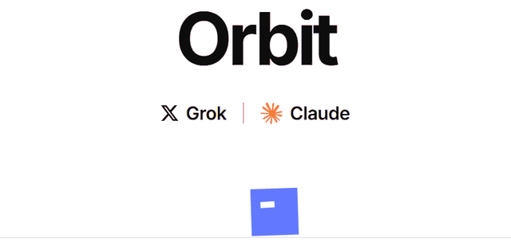
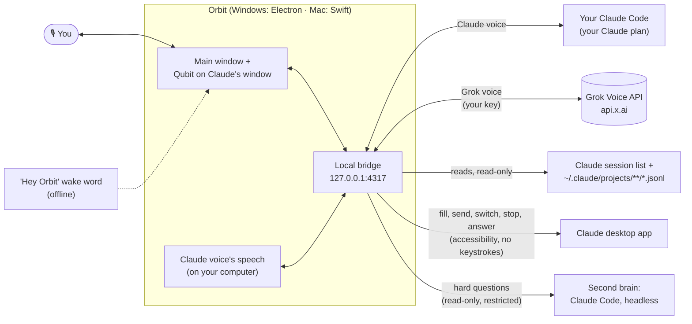

<p align="center"><a href="https://cookiebubba.github.io/orbit-voice/"></a></p>

<p align="center"><b>Talk to Claude Code, hands-free.</b><br>
Orbit is a voice companion for the Claude desktop app. Ask what Claude is doing, hear when it finishes, dictate prompts, answer its questions and switch sessions without touching the keyboard. Qubit, Orbit's avatar, lives on your Claude window while you talk.</p>

<p align="center">
  <a href="https://github.com/Cookiebubba/orbit-voice/actions/workflows/ci.yml"></a>
  <a href="../../releases"></a>
  
  
  <a href="LICENSE"></a>
  <a href="SECURITY.md"></a>
</p>

<p align="center">
  <a href="https://github.com/Cookiebubba/orbit-voice/releases/download/v1.3.0-beta.4/Orbit-Setup-1.3.0-beta.4.exe"><b>⬇ Download for Windows</b></a> ·
  <a href="https://github.com/Cookiebubba/orbit-voice/releases/download/v1.3.0-beta.4/Orbit-Native-1.3.0-beta.4-arm64.dmg"><b>⬇ Download for Mac</b></a> ·
  <a href="https://cookiebubba.github.io/orbit-voice/">Website</a> ·
  <a href="#how-it-works">How it works</a> ·
  <a href="SECURITY.md">Security</a>
</p>

<p align="center"><sub>The newest release, 1.3.0 beta 4. <a href="../../releases">All releases</a> · <a href="RELEASE_NOTES.md">what's new</a></sub></p>

> Orbit is an independent open-source project. It is not affiliated with, endorsed by, or sponsored by xAI or Anthropic. Grok is a trademark of xAI; Claude is a trademark of Anthropic.

---

## What Orbit does

- **Two voices, your choice.** Orbit talks with **Claude voice** (the default) or **Grok voice**:
  - **Claude voice** runs on your own Claude Code sign-in, so it counts toward your Claude plan. Orbit hears you and speaks on your computer (Silero, Moonshine or Parakeet, Kitten TTS). No key, no extra bill.
  - **Grok voice** is xAI's realtime voice: the quickest replies, billed by xAI per minute with your own key.
  - Switch any time in Settings → Voice engine, or pick one in the first-run setup.
- **Qubit lives on your Claude window.** A square with one eye stands on Claude's prompt box. He sleeps while Orbit sleeps, listens as you talk (his eye stretches with your voice), speaks with Orbit's voice, waits by Send for your yes, watches Claude work and celebrates when it's done. Ask him for a backflip. Pick him up and throw him. Prefer something else? Choose the pixel buddy or no avatar, and on Windows the floating orb.
- **Talk to your sessions.** "What's Claude doing?", "Did it finish?", "Summarize my launchpad session." Orbit reads your Claude Code sessions from disk and answers out loud.
- **Hear when Claude is done.** A chime, a notification, and (optionally) Orbit telling you what Claude did. With "wake to say it" on, Orbit connects just long enough to say it, then listens for 3 seconds for your reply.
- **Dictate prompts, safely.** "Tell Claude to run the tests." Orbit types the draft into Claude's prompt box and asks "Send it?". Ask for changes by voice and it redrafts. Nothing is sent until you say **yes**.
- **Answer Claude when it's waiting.** When Claude asks permission or asks a question, Orbit tells you the risky part ("It wants to run npm install. Allow it?") and clicks Claude's own button for your answer.
- **Switch, start and stop sessions by voice.** "Switch to my Ladder 6 session", "new session in castpilot", "stop".
- **Orbit anywhere.** Ask about or act in other apps' windows: read what's in them, click "Wi-Fi" in System Settings, type into a chat box (outward acts like Send wait for your yes), or look at a window ("what's on this chart?"). Orbit's own mouse shows where it's working. See [docs/ORBIT-ANYWHERE.md](docs/ORBIT-ANYWHERE.md).
- **A second brain for hard questions.** For deep or code-specific questions, Orbit quietly asks Claude (Haiku, Sonnet or Opus), read-only in your current project, and tells you the answer.
- **Web search** for current facts, and **copy to clipboard** ("copy Claude's last answer").
- **Say "Hey Orbit".** An optional, fully offline wake word. No audio leaves your computer until Orbit is awake.
- **You control the mic, and the bill.** Say "go to sleep" and Orbit hangs up. The hotkey (default **Ctrl+Alt+G** on Windows, **⌘⌥G** on Mac) starts, sleeps and wakes it.
- **Picks up where you left off.** For 30 minutes after a call, the next one gets a short note on where you were, kept in memory only.

## Get Orbit

| | Windows | Mac |
| --- | --- | --- |
| Download | [`Orbit-Setup-1.3.0-beta.4.exe`](https://github.com/Cookiebubba/orbit-voice/releases/download/v1.3.0-beta.4/Orbit-Setup-1.3.0-beta.4.exe) | [`Orbit-Native-1.3.0-beta.4-arm64.dmg`](https://github.com/Cookiebubba/orbit-voice/releases/download/v1.3.0-beta.4/Orbit-Native-1.3.0-beta.4-arm64.dmg) |
| System | Windows 10 or 11 (x64) | macOS 14 or later, Apple silicon |
| The app | Orbit (Electron) | Orbit Native, a native Swift app (beta) |

**Windows:** run the installer. It isn't code-signed yet, so on the SmartScreen prompt click **More info → Run anyway**. You can check the download against the `.sha256` file on the release page.

**Mac:** open the dmg and drag **Orbit Native** to Applications. It isn't notarized by Apple yet, so the first time:
1. Open it. macOS says it can't check it for malicious software. Click **Done**.
2. Open **System Settings → Privacy & Security**, scroll down, click **Open Anyway** next to Orbit Native and confirm.
3. Orbit walks you through choosing a voice, then asks for the **Microphone** and **Accessibility**. If macOS asks about the Keychain, choose **Always Allow**.

Until the app is notarized, macOS may ask for Accessibility and the Keychain again after an update. More in [docs/MAC.md](docs/MAC.md).

**Then:** click Qubit or press the hotkey and start talking. There's no key to enter for Claude voice.

## What you need

- The [Claude desktop app](https://claude.ai/download) with Claude Code sessions.
- **Claude Code, signed in.** Claude voice, the second brain and web search run through it. The Claude desktop app may already include it, and Orbit finds it. If not, Orbit shows the install command with **Copy** and **Check again** (it never runs the installer itself):

  ```powershell
  irm https://claude.ai/install.ps1 | iex          # Windows (PowerShell)
  ```
  ```bash
  curl -fsSL https://claude.ai/install.sh | bash   # Mac (Terminal)
  ```

  Then run `claude` once and sign in with your Claude account. Anthropic's [setup guide](https://code.claude.com/docs/en/setup) has the details.
- **Only for Grok voice:** an [xAI API key](https://console.x.ai), added in Settings → Voice engine → Grok. Grok voice is billed by xAI per minute connected (about $0.08/min at the time of writing); Orbit shows an estimate in Settings → Usage. Sleeping costs nothing.
- Claude voice's speech models (about 175 MB) download the first time you talk, and stay on your computer.

## Using it

| Say or do | What happens |
| --- | --- |
| "What's Claude doing right now?" | Orbit reads the open session and sums it up |
| "List my sessions" / "What happened in the shakeout session?" | Finds and reads other sessions |
| "Switch to the launchpad dashboard" | Opens that session in Claude |
| "Start a new session" / "New thread in castpilot" | Opens a new, empty Claude session, then asks what to tell Claude |
| "Tell Claude: add a dark mode toggle" | Types the draft into Claude's box and waits for your "yes" |
| "Stop" / "stop it, it's going the wrong way" | Presses Claude's Stop button |
| "What's it asking?" / "Allow it" / "Deny that" / "Go with the second option" | Reads what Claude is waiting on, and clicks your answer |
| "What's in this window?" / "Click Wi-Fi" / "Type running late in Discord and send it" | Orbit anywhere: reads or acts in the window you're in |
| "Search the web for the latest Node LTS version" | Looks it up and tells you |
| "Qubit, do a backflip" | He does |
| "Go to sleep" | Orbit says goodbye and hangs up |
| "Hey Orbit" / the hotkey / click Qubit | Starts a fresh conversation (turn the wake word on in Settings → Listening) |
| "Copy Claude's last answer" | Puts it on your clipboard |
| "What went wrong?" | Orbit reads its recent error log and explains |
| Title bar → session name | Pick a session to open it, or ask about it |
| Title bar → clock / gear | This run's conversation (never saved) / Settings |

## How it works



- **Driving Claude** goes through the operating system's accessibility API: UI Automation on Windows, the macOS accessibility API on a Mac (Orbit's small `orbit-helper`, source in [`native/mac/OrbitHelper`](native/mac/OrbitHelper)). Sending a prompt fills Claude's prompt box and presses Claude's own Send button: no key presses, focus changes or clipboard. It refuses if the box already has your own typing or if it can't confirm the text landed, and checks the session again just before Send.
- **Several Claude windows:** Orbit works in the one you were in last, the one Qubit stands on.
- **Switching sessions** brings forward the window the session is open in, or presses its sidebar button and confirms the title changed. **New sessions** press Claude's own New button; nothing is typed until your first prompt goes through the usual draft and "yes".
- **Claude voice** keeps a Claude Code process ready in its streaming mode and speaks its words as they come, recognised and spoken on your computer. **Grok voice** is xAI's realtime API with your key.
- **Spoken updates while asleep** connect only when Claude finishes and the setting is on. No mic audio goes anywhere until the update has been spoken, then for about 3 seconds; only words (not a cough) carry the conversation on.
- **The wake word** uses [Vosk](https://alphacephei.com/vosk/) (a small English model, about 40 MB, shipped with Orbit), offline. On 160 clips across 14 voices it woke on 46 of 46 "Hey Orbit" and on none of 110 sound-alikes ("Hey Robert", "Hey rabbit", "It's in orbit"...).
- **The second brain** runs your own Claude Code headless (`claude -p`), isolated: none of your Claude Code settings, hooks, plugins or MCP servers, no Bash or edit tools, `.env` files and keys denied, nothing saved to your history. It's capped at 1, 2.5 or 5 minutes for Haiku, Sonnet or Opus and answers in a fixed, checked shape.
- **Qubit on Claude's window** follows it as it moves, resizes, minimizes or changes desktop, from the operating system's own window events (under 1% of a core while idle). He stays above Claude but not over other apps.
- **Updates** come from this repository's GitHub Releases, checked against the SHA-512 in the release's update file before they're kept. A beta install updates to later betas and to the next stable release.
- Settings, usage and logs live in `%APPDATA%\Orbit` (Windows) or `~/Library/Application Support/Orbit Native` (Mac).

## Privacy and terms of use

- Orbit is a **voice input method** for you, like dictation. Every prompt is yours, put in front of you, and sent only after you confirm: the app enforces it in code (a voice "send" goes through only if your reply after the draft is a clear yes). Please don't modify Orbit to send prompts automatically or run Claude unattended through its UI. For automation, use Claude Code's headless mode (`claude -p`) or the Agent SDK.
- What the voice reads of your sessions goes to the voice you use: **Anthropic** through your Claude Code (Claude voice), or **xAI** (Grok voice). With Grok voice, don't use Orbit on sessions holding secrets you wouldn't share with xAI.
- The second brain sends the question to **Anthropic** through your Claude Code, with the recent messages of your open session and any project files Claude reads. Turn it, or just "Read the current project", off in Settings.
- Web search sends the question to **xAI** (Grok voice) or to **Anthropic** through your Claude Code (Claude voice). Turn it off in Settings → Second brain.
- **Updates:** Orbit asks GitHub for the newest release's update info when it starts and every few hours (turn "Update automatically" off to check only on demand). Orbit sends nothing about you.
- Nothing else leaves your computer. There's no telemetry. Logs never contain keys or prompt text. The wake word listens only on your computer and never records or sends audio.

## Build from source

**Windows** (Node.js 20+):

```bash
npm ci
npm run build:ui
npm run app
```

`npm run dist` builds the installer into `dist/`. `npm run web` runs the same UI in a browser tab. `npm run check` reads your sessions without needing a key.

**Mac, Orbit Native** (Xcode, Node.js): `npm ci`, `npm run build:ui` and `node scripts/fetch-model.mjs` at the root, then `mac-swift/scripts/build-app.sh` builds `Orbit Native.app` and `mac-swift/scripts/package.sh` the dmg and zip. See [mac-swift/README.md](mac-swift/README.md) and [docs/MAC.md](docs/MAC.md).

Project layout: `src/` the local bridge, voice tools, session reader and watcher · `ui/` the React UI · `electron/` the Windows shell · `mac-swift/` Orbit Native, the Swift app · `native/mac/` the Mac accessibility helper · `parity/` the cases Orbit Native must pass, written from what the core does.

### Testing

None of these touch the real Claude app, xAI or Anthropic, or your own settings.

| Command | What it runs |
| --- | --- |
| `npm test` | Unit tests, plus `test/sandboxed/` with the Claude window and the second brain swapped for fakes |
| `npm run fuzz -- --seed N` | In-process fuzzer: random tool calls, bridge messages and a fake Grok |
| `npm run fuzz:e2e -- --seed N --iterations M` | The real app, hidden, against a fake Grok, a fake `claude.exe`, a fake Claude window and throwaway sessions. It fails on a crash or hang, a prompt sent without a fresh yes, a key or your words in the logs, and more |
| `cd mac-swift && swift test` | Orbit Native's tests (needs a Mac) |
| `npm run parity` | The parity cases against a test build of Orbit Native, on a Mac ([parity/PROTOCOL.md](parity/PROTOCOL.md)) |

## Security

See [SECURITY.md](SECURITY.md) for the threat model, what Orbit does to protect you, the published security review, and how to report a vulnerability.

## License

[MIT](LICENSE). Third-party components are listed in [THIRD_PARTY_NOTICES.md](THIRD_PARTY_NOTICES.md).
