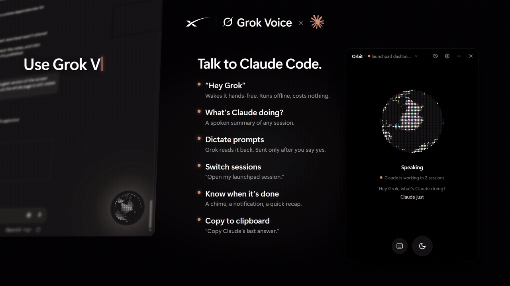
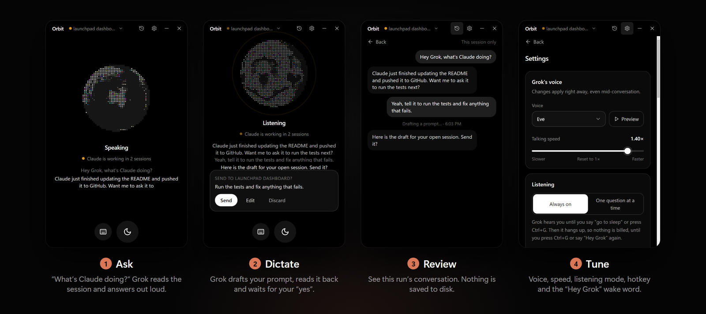
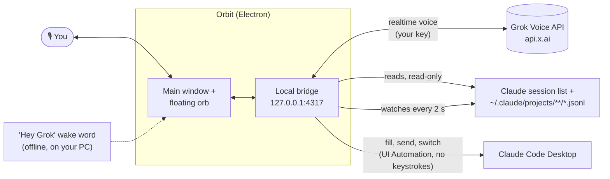

<p align="center"><a href="docs/demo.mp4"></a></p>

<h1 align="center"> Orbit</h1>

<p align="center"><b>A hands-free voice companion for Claude Code Desktop, powered by Grok Voice.</b><br>
Ask what Claude is doing, hear when it finishes, switch sessions, and dictate prompts, without touching the keyboard.</p>

<p align="center">
  <a href="../../releases/latest"></a>
  
  <a href="LICENSE"></a>
  <a href="SECURITY.md"></a>
</p>

<p align="center"><a href="../../releases/latest"><b>⬇ Download for Windows</b></a> · <a href="docs/demo.mp4">Watch the demo (MP4)</a> · <a href="#how-it-works">How it works</a> · <a href="SECURITY.md">Security</a></p>

<p align="center"></p>

> Orbit is an independent open-source project. It is not affiliated with, endorsed by, or sponsored by xAI or Anthropic. Grok is a trademark of xAI; Claude is a trademark of Anthropic.

---

## What it does

- **Talk to your sessions.** "What's Claude doing?", "Did it finish?", "Summarize my launchpad session." Orbit reads your Claude Code sessions from disk and Grok answers out loud.
- **Hear when Claude is done.** Orbit watches your recent sessions and plays a chime, shows a Windows notification, and (optionally) has Grok tell you what Claude did.
- **Dictate prompts, safely.** "Tell Claude to run the tests." Grok drafts it and reads it back. It only types into Claude's prompt box after you say **yes**. You can edit the draft first.
- **Switch sessions by voice or click.** "Switch to my Ladder 6 session." Orbit opens it in Claude's sidebar, without moving your mouse.
- **Stays out of the way.** Minimize it to a small always-on-top orb. The orb glows when you talk, dims when it's asleep, and pulses amber while Claude is working.
- **You control the mic, and the bill.** Say "go to sleep" and Orbit hangs up, so nothing is billed while it sleeps. Or use **one question at a time** mode: press the hotkey (default **Ctrl+Alt+G**, changeable), ask, and it hangs up after answering.
- **Say "Hey Grok" (optional).** A free, fully offline wake word starts Grok again after it has gone to sleep. It's recognized on your PC by a small speech model, so no audio leaves your computer until Grok is awake. Each wake starts a fresh conversation: Grok doesn't remember the previous one, but it can always re-read your Claude sessions.
- **Copy to clipboard.** "Copy Claude's last answer", "copy that command": Grok puts it on your clipboard, ready to paste.

## Requirements

- Windows 10 or 11 (x64)
- [Claude desktop app](https://claude.ai/download) with Claude Code sessions
- An [xAI API key](https://console.x.ai). Voice is billed by xAI per minute connected (about $0.08/min at the time of writing). Orbit shows an estimate in Settings → Usage. Saying "go to sleep" hangs up, so sleeping costs nothing.

## Install

1. Download `Orbit-Setup-x.y.z.exe` from the [latest release](../../releases/latest).
2. Run it. The installer isn't code-signed yet, so Windows SmartScreen may warn you. Click **More info → Run anyway**. You can check the download against the `.sha256` file on the release page.
3. Paste your xAI key when Orbit asks. It's encrypted with your Windows account (DPAPI) and never leaves your PC except to talk to xAI.
4. Click the orb or press **Ctrl+Alt+G** and start talking.

## Using it

| Say or do | What happens |
| --- | --- |
| "What's Claude doing right now?" | Grok reads the open session and summarizes it |
| "List my sessions" / "What happened in the shakeout session?" | Finds and reads other sessions |
| "Switch to the launchpad dashboard" | Opens that session in Claude |
| "Tell Claude: add a dark mode toggle" | Shows a draft, reads it back, waits for your "yes" |
| "Go to sleep" | Grok says goodbye and Orbit hangs up (nothing billed) |
| "Hey Grok" / the hotkey / click the orb | Starts a fresh conversation (turn the wake word on in Settings → Listening) |
| "Copy Claude's last answer" / "Copy that" | Puts it on your clipboard |
| "What went wrong?" | Grok reads Orbit's recent error log and explains |
| Title bar → session name | Pick a session to open it, or ask Grok about it |
| Title bar → clock icon | Conversation history (this run only, never saved) |
| Title bar → gear | Voice, speed, listening mode, notifications, hotkey, start with Windows, usage |
| Floating orb | Click: open · drag: move · right-click: sleep/wake |

## How it works



- Claude's **Microsoft Store** version keeps its session list in `%LOCALAPPDATA%\Packages\Claude_*\LocalCache\Roaming\Claude`. The regular installer uses `%APPDATA%\Claude`. Orbit checks both.
- **Sending a prompt** fills Claude's prompt box through Windows accessibility and presses Claude's own Send button. There are no key presses, focus changes or clipboard use. It refuses if the box already has your own typing, if a different session is open than the one the draft was for, or if it can't confirm the text landed.
- **Switching sessions** presses the session's sidebar button through accessibility, and confirms the window title changed.
- **The wake word** uses [Vosk](https://alphacephei.com/vosk/) (small English model, ~40 MB, shipped with the installer) running in a hidden helper page. "Grok" isn't in that model's vocabulary, so Orbit listens for close matches ("hey rock", "hey brock") and gives the model decoy names ("Brooke", "Rob", "Bob", "Rocky"...) so similar names don't trigger it. In testing it caught 10 of 10 "Hey Grok" clips across 9 voices and ignored 12 of 13 sound-alikes. The one miss was someone actually saying "Hey Brock".
- Settings, usage and logs live in `%APPDATA%\Orbit`.

## Privacy and terms of use

- Orbit is a **voice input method** for you, like dictation. Every prompt is yours, shown to you, and sent only after you confirm. Grok can't send on its own. The app enforces this in code: a voice "send" only goes through if your transcribed reply after the draft is a clear yes. Please don't modify Orbit to send prompts automatically or run Claude unattended through its UI. For automation, use Claude Code's official headless mode (`claude -p`) or the Agent SDK.
- The parts of your sessions Grok reads are sent to **xAI** to answer you. Don't use Orbit on sessions containing secrets you wouldn't share with xAI.
- Nothing else leaves your computer. There's no telemetry and no auto-update. Logs never contain keys or prompt text.
- The wake word listens only on your PC, only while it's turned on and Grok is off or asleep. Its audio is never recorded or sent anywhere.

## Build from source

Requires Node.js 20+ on Windows.

```bash
npm ci
npm run build:ui
npm run app
```

`npm run dist` builds the installer into `dist/`. `npm run web` runs the same UI in a browser tab (no floating orb or hotkey). `npm run check` reads your sessions without needing a key.

Project layout: `electron/` window shell, tray and hotkey · `src/` local bridge, Grok tools, session reader and watcher, Windows automation script · `ui/` React UI.

## Security

See [SECURITY.md](SECURITY.md) for the threat model, what Orbit does to protect you, the published security review, and how to report a vulnerability.

## License

[MIT](LICENSE). Third-party components are listed in [THIRD_PARTY_NOTICES.md](THIRD_PARTY_NOTICES.md).
