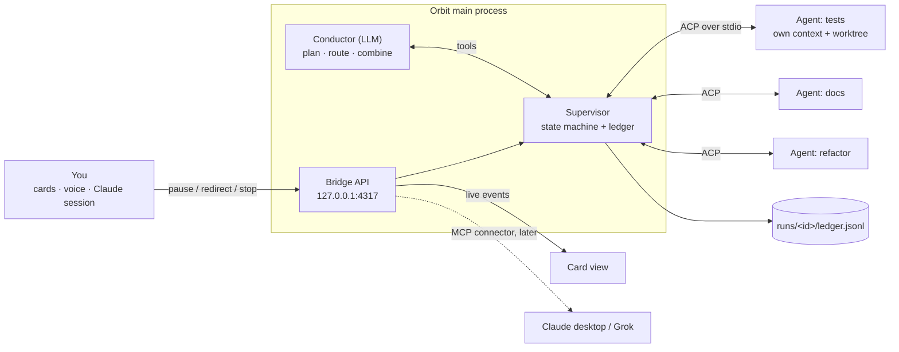
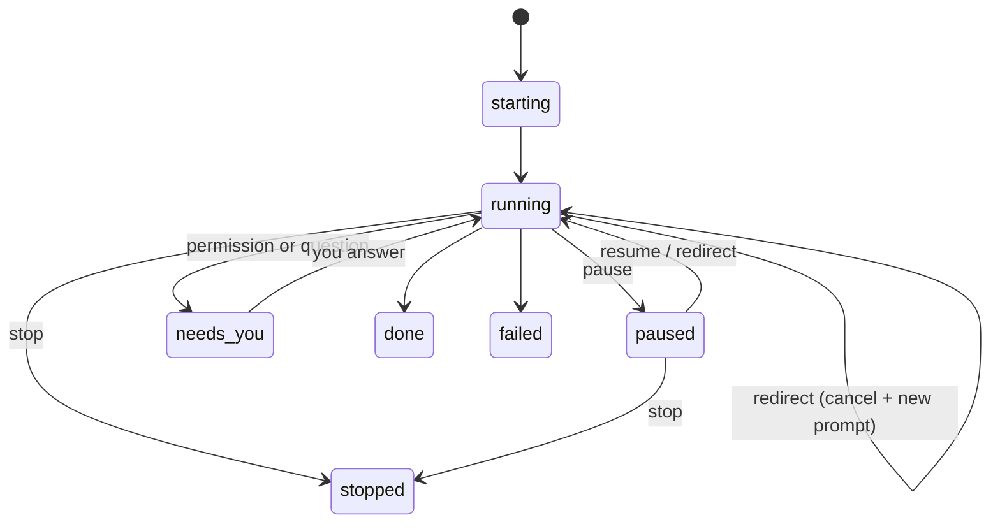
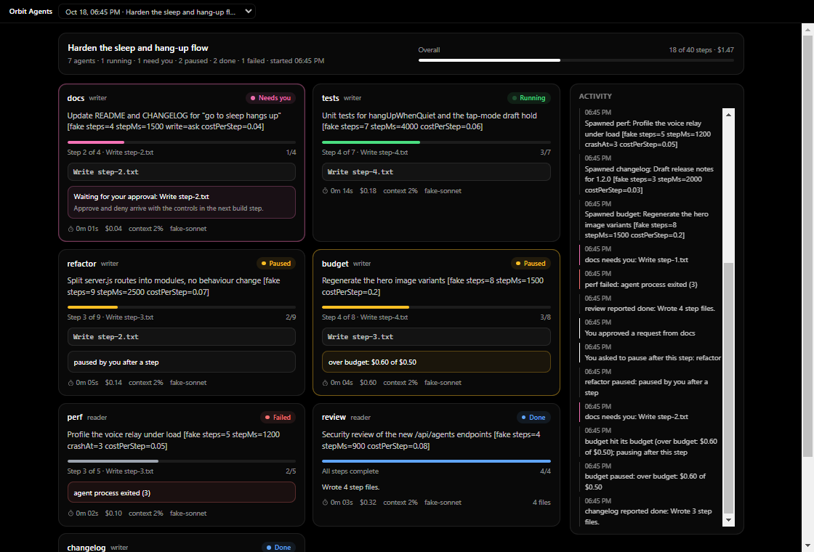

# Orbit Agents: orchestration design (draft)

Status: draft, 2026-10-18. Build step 1 (the ACP spike) is done and passed; see [Spike results](#spike-results-build-step-1). Card-view mockup: [agent-cards.html](agent-cards.html).

## Goal

One lean orchestrator runs many sub-agents, and each sub-agent has its own context window. The orchestrator routes tasks, tracks every agent and combines their reports into one result. Sub-agents never talk to each other. Orbit shows each agent as a card. You can pause, redirect or stop any card without ending the run.

## Two decisions up front

**1. ACP connects Orbit to the sub-agents; MCP connects Claude's desktop app.**
- The Agent Client Protocol (ACP) is how an app hosts coding agents. Zed and JetBrains use it.
- With ACP, the host can:
  - start an agent and send it prompts
  - stream the agent's plan, tool calls and messages
  - cancel the agent's current turn
- The orchestrator needs exactly those things. So Orbit becomes an ACP **client**, and each sub-agent is an ACP **agent**: Claude Code through its ACP adapter, or any other agent that speaks ACP.
- Claude's desktop app accepts add-ons through **MCP connectors**, not ACP. So the visibility layer has two parts:
  - the card view in Orbit's own window
  - an optional MCP connector, so a Claude session (or Grok, by voice) can list and steer agents

**2. Split the orchestrator into two parts.**
- **Supervisor:** plain code. It owns the agent processes, their state and the event log.
- **Conductor:** an LLM. It only plans, routes and combines results, using tools the Supervisor provides.
- Why this keeps the Conductor lean:
  - It never holds process state, so it can be compacted or restarted mid-run without losing anything.
  - Its context grows only by short reports.

## Architecture



| Piece | What it is | What it owns |
| --- | --- | --- |
| Supervisor | Node module in Orbit's main process | Agent processes, the state machine, budgets, the ledger, control commands |
| Conductor | Claude Agent SDK loop, one per run | The plan, task routing, the final summary. It sees only task specs and reports. |
| Sub-agent | Child process that speaks ACP over stdio. Default: Claude Code through its ACP adapter, swappable for another ACP agent. | Its own context window, its task, its worktree |
| Ledger | Append-only JSONL file per run | The source of truth for cards, replay and crash recovery |
| Bridge API | Orbit's existing local server, with the same cookie auth | REST endpoints for controls, a WebSocket for live events |
| Card view | New Orbit window | Displays agents and sends controls. Nothing else. |
| MCP connector (later) | Small MCP server over the same API | List, pause and redirect agents from Claude or by voice |

### Conductor tools

- `spawn_agent(task, role, writes, budget)` returns an agent id.
- `message_agent(id, text)` sends a follow-up or a redirect. It cancels the agent's current turn first.
- `pause_agent(id)`, `resume_agent(id)`, `stop_agent(id)`.
- `wait(mode, ids)` returns reports as they arrive. Mode is "any" or "all".
- `read_report(id)` returns an agent's final structured report.
- `finish(summary)` ends the run.

No tool reads a sub-agent's transcript. If the Conductor needs more detail, it asks the agent through `message_agent` and gets a short answer. This rule keeps it lean.

### Report format

Every sub-agent ends with one JSON block. The Supervisor checks it and asks the agent once to resend it if it's malformed.

```json
{
  "status": "done | blocked | failed",
  "summary": "120 words or fewer",
  "changes": ["ui/src/useVoice.test.ts"],
  "branch": "agents/run-7/tests",
  "questions": [],
  "next": "optional suggestion for the Conductor"
}
```

### Agent states



### Where each card field comes from

Every field below comes from ACP's `session/update` stream or from the Supervisor itself. The spike confirmed each source.

The Supervisor gives every sub-agent a tiny `orbit` MCP server through `session/new`'s `mcpServers` parameter. Its only tool is `report_progress(done, total, step)`. It does nothing itself: the Supervisor reads the call's arguments off the ACP stream. In the spike, Claude never sent ACP `plan` updates on its own, so progress can't depend on them.

| Card field | Source |
| --- | --- |
| Progress ("4 of 7") | `done` and `total` from the latest `orbit.report_progress` call. ACP `plan` updates are used if an agent sends them. |
| Current step | `step` from the same call |
| Live activity ("Write step-1.txt") | The latest `tool_call_update` title and `locations`. The first `tool_call` only carries a placeholder such as "Preparing file…". |
| Needs you | A `session/request_permission` the Supervisor is holding |
| Context, model and cost | `usage_update`: context used out of the window size, the model, and the session's running cost in USD |
| Elapsed time | The Supervisor's clock |

Tool arguments stream in pieces (`rawInput` fills in over several updates), so the card updates only once `done`, `total` and `step` are all present.

### Pause, resume and redirect

ACP has no pause command, but its other messages are enough. None of these actions affect the other agents or the Conductor.

- **Pause now:** the Supervisor sends `session/cancel`.
  - The agent ends its turn at the next safe point and reports that it was cancelled.
  - The session and its context stay alive, and the card shows Paused.
- **Pause after this step:** the Supervisor holds the agent's next `orbit.report_progress` permission request instead of answering it.
  - The agent calls that tool between steps, so this always stops at a step boundary and nothing is cut off mid-edit.
  - It doesn't depend on file writes asking for permission.
  - In the spike, a 6-second hold produced 1 update (the request itself) and no tool activity.
- **Resume:** sends `session/prompt` with "Continue where you left off."
- **Redirect:** cancels the current turn if one is running, then sends `session/prompt` with your instruction, prefixed "Change of plan from the user:".
  - The agent keeps its context and takes the new direction.
  - The Conductor gets a ledger event, so its plan stays accurate.
- **Stop:** cancels the turn and ends the process. The worktree is kept so you can inspect it.

### Isolation and safety

- **Worktrees:** each agent that writes code gets its own git worktree on a branch named `agents/<run>/<name>`. Agents that only read share the checkout.
- **Merging:** the Conductor merges branches only at the end of the run. A merge conflict becomes a new task, never a silent overwrite.
- **Isolation from your setup:** sub-agents never inherit your Claude Code settings.
  - Without isolation, the spike's agent started in your `bypassPermissions` mode and on your default model.
  - It also inherited your global allow rules: Bash, Write and Edit, and your Gmail, Slack and Drive connectors.
  - The Supervisor therefore starts every session with:
    - `_meta.claudeCode.options = { settingSources: [], strictMcpConfig: true, allowDangerouslySkipPermissions: false }`
    - mode `default`
    - an explicit model for each role
  - It then passes in only the MCP servers and allow rules that role needs.
- **Permissions:** with isolation on, every write asks for permission, and you approve it on the card's "Needs you" state. Per-role allowlists come later.
- **Budgets:** each agent has a limit on time, tokens and cost, enforced by the Supervisor. An agent over budget pauses after its current step, and its card turns amber.
- **Confirmed redirects:** redirects by voice or through MCP follow Orbit's existing consent rule. Text from a transcript never counts as you, and a redirect is sent only after you confirm it.
- **Bridge security:** the new endpoints use the existing cookie auth and the existing Host and Origin checks.

## Card view

See the [mockup](agent-cards.html).

- **Header:** the run's goal, overall progress, what the Conductor is doing, and **Pause all** / **Stop run** buttons.
- **One card per agent:**
  - name and role
  - task in one line, and a status pill
  - progress bar with the current step
  - live activity line
  - elapsed time and cost
  - Pause / Resume, Redirect (opens a text box on the card), Stop, and Details (the plan list and last report)
- **"Needs you" cards:** they move to the top of the grid.
- **Conductor feed:** shows the Conductor's routing decisions and the summary as it builds up.

## Build order

Each step is useful on its own and lowers the risk of the next one.

1. **ACP spike (half a day). Done, passed:** [spikes/acp](../../spikes/acp). A Node script does the following:
   - starts one Claude Code agent over ACP and sends it a prompt
   - logs every `session/update`
   - sends `session/cancel` mid-turn, then a follow-up prompt

   This proves that the progress data exists, that cancelling keeps the context, and that redirecting works. It gates everything else.
2. **Supervisor and ledger (1–2 days). Done:** [src/agents](../../src/agents), 18 tests in [test/agents.test.js](../../test/agents.test.js); see [Step 2 results](#step-2-results).
   - Starts N agents from a hand-written JSON task list.
   - Adds the state machine, budgets, the JSONL ledger and replay after a crash.
   - Unit tests run against a fake ACP agent.
3. **Read-only card view (1 day). Done:** see [Step 3 results](#step-3-results). Bridge endpoints and a WebSocket stream, with cards built from the ledger. Already useful for watching parallel work.
4. **Controls (1 day). Done:** see [Step 4 results](#step-4-results). Pause now, pause after this step, resume, redirect and stop. Tested end to end against the fake agent and one real agent.
5. **Conductor (2 days).**
   - The Agent SDK loop with the tools above, the report format, and the final summary.
   - You give it a goal; it makes a plan, runs agents and returns a summary.
6. **Worktrees and merging (1 day).**
7. **Voice and MCP connector (1–2 days).**
   - Grok handles:
     - "what are the agents doing?"
     - "pause the docs agent"
     - "tell tests to skip the end-to-end tests", which needs your confirmation
   - An MCP server gives Claude the same controls.
8. **Hardening.**
   - Per-role permission allowlists and a cost view.
   - Resuming a run after Orbit restarts.
   - A security review of the new endpoints.

## Spike results (build step 1)

The spike ran 2026-10-18 against `@agentclientprotocol/claude-agent-acp` 0.85.1 and ACP SDK 1.6.0, on ACP protocol v1. Code and logs are in [spikes/acp](../../spikes/acp).

Each run gives one real agent a 6-step file task in a temp folder, plus a codeword that it is never allowed to write to disk. The script then:
1. holds a permission request for 6 seconds
2. cancels the agent after step 2
3. asks the agent, without tools, for the codeword and where it stopped
4. resumes the agent and cancels it again after step 3
5. redirects the agent to a new format for the remaining files
6. checks the files on disk

| Check | Run 1: your settings | Run 2: mode and model set | Run 3: isolated |
| --- | --- | --- | --- |
| Cancel ends the turn (`stopReason: cancelled`) | ✅ 16 ms | ✅ 10 ms | ✅ 17 ms |
| Nothing written after cancel | ✅ | ✅ | ✅ |
| Memory kept after cancel (codeword recalled) | ✅ | ✅ | ✅ |
| Knows where it stopped ("2 files") | ✅ | ✅ | ✅ |
| Resume continues the task | ✅ | ✅ | ✅ |
| Redirect changes direction (files 1–3 poems, 4–6 redirected) | ✅ | ✅ | ✅ |
| Earlier work untouched (hashes match) | ✅ | ✅ | ✅ |
| Progress data for the card | ❌ no `plan` updates | ✅ 6 `report_progress` calls | ✅ |
| Soft pause by holding a permission request | ❌ nothing asked (bypass mode) | ✅ | ✅ |
| File writes ask permission | ❌ | ❌ (your allow rules) | ✅ |
| Starting mode / model | bypassPermissions / Fable 5.1 | default / Sonnet 5.5 | default / Sonnet 5.5 |
| Context after phase A | ~77k tokens | ~70k | ~35k |
| Cost through phase A | ~$1.62 | $0.31 | $0.07 |

**What this changes in the design:**
- **Progress:** comes from the injected `orbit.report_progress` tool instead of ACP `plan` updates.
- **Pause after this step:** holds that tool's permission request.
- **Isolation:** every session starts isolated, as described under Isolation and safety, so cost and risk stay bounded.
- **Activity line:** uses the latest `tool_call_update` title, because the first one is a placeholder.

**Unknowns for step 2:**
- **First tool call:** in all three runs, the agent spent ~1 s on `ToolSearch` before its first real tool call. A short tool list for each role may avoid that.
- **Long pauses:** a cancel that lands mid-tool-call wasn't tested on a long-running command, such as a 30-second test run.
- **Crash recovery:** `resumeSession` and `closeSession` exist in the SDK and fit replaying a run after a crash. They are untested.

## Step 2 results

**Files:**
- [`src/agents/ledger.js`](../../src/agents/ledger.js): the append-only JSONL ledger and the single reducer that turns events into cards.
- [`src/agents/supervisor.js`](../../src/agents/supervisor.js): processes, ACP sessions, the state machine, controls and budgets.
- [`src/agents/progress-mcp.js`](../../src/agents/progress-mcp.js): the injected progress tool.

The Supervisor keeps no agent state of its own. Every change is an appended event, and the cards come from replaying events, so the live view and crash recovery run the same code.

**API, for the Conductor (step 5) and the bridge (step 3):**

| Call | What it does |
| --- | --- |
| `Supervisor.create({ runsDir, goal, agentCommand, model, maxConcurrent, autoApprove })` | Starts a new run |
| `Supervisor.open(runDir, opts)` | Re-opens a run after a crash. Agents that were mid-work become `interrupted`, and queued agents wait for `resumeQueue()`. |
| `spawn({ name, task, role, writes, cwd, budget: { costUsd, ms, contextTokens }, model })` | Adds an agent and returns its id |
| `pause(id, { when: 'now' \| 'step' })`, `resume(id)`, `redirect(id, text)`, `stop(id)` | Controls one agent |
| `restart(id)` | Starts an interrupted or failed agent in a new process |
| `answer(id, allow)` | Answers the card's "Needs you" |
| `message(id, text)` | Asks an agent a question and returns its answer. The card goes back to its previous state, and no report is expected. |
| `wait(ids, 'all' \| 'any')` | Resolves when those agents settle |
| `cards()` | Returns the card view model |
| `on('event', fn)` | Streams ledger events |

States: `queued`, `starting`, `running`, `needs_you`, `paused`, `idle`, `blocked`, `done`, `failed`, `stopped`, `interrupted`.

**Tests:** `npm test` runs 18 tests in about 20 seconds against a scripted ACP agent ([test/fixtures/fake-acp-agent.js](../../test/fixtures/fake-acp-agent.js)) that speaks real ACP. The suite passed 3 runs in a row. It covers:
- progress and activity, including skipping placeholder titles
- isolation, mode and model
- concurrency limits
- pause now with memory kept, and pause after a step
- redirect while running and while parked
- stop
- "Needs you" approve and deny, and the autoApprove policy
- cost and time budgets
- a missing report: one reminder, then failure
- an agent crash
- replaying a run after Orbit dies, then restarting the agent

**Real-agent smoke test:** [spikes/acp/supervisor-smoke.mjs](../../spikes/acp/supervisor-smoke.mjs) ran two Claude Sonnet agents in parallel and passed 10 of 10 checks in 23 seconds, for about $0.17. Results:
- The writer was paused after step 1, stayed parked for 5 seconds with no file changes, then resumed and finished 4 of 4.
- The reader's shell command waited on "Needs you" until it was approved.
- Both agents sent valid reports.
- A follow-up question after the writer finished got the right answer.

**What it taught us:**
- **Follow-up questions:** these needed their own turn type. Otherwise the Conductor asking for detail would trigger the "missing report" reminder.
- **Event ordering:** an agent's turn handle must be cleared before its "done" event goes out, or a listener that reacts right away sees the agent as busy. The smoke test caught this, and a regression test now covers it.
- **Isolated agents ask about shell commands, even read-only ones.** Per-role allowlists (step 8) will matter for usability. Until then, the card's "Needs you" handles them.
- **Restart:** `restart()` gives the agent a fresh session plus a note with its last progress. Restoring the old context with ACP `loadSession`/`resumeSession` is still untested; it belongs to step 8.

## Step 3 results



**Read side:** [`src/agents/hub.js`](../../src/agents/hub.js) reads run ledgers from `%APPDATA%\Orbit\agents\runs` and tails them every 250 ms. It doesn't talk to the Supervisor, so the view works for a run in Orbit's own process or in any other process that writes a ledger. It can't change a run.

**Bridge endpoints:** all sit behind the existing session cookie and the Host, Origin and `Sec-Fetch-Site` checks.

| Endpoint | Returns |
| --- | --- |
| `GET /api/agents/runs` | Runs, newest first: goal, agent count, active count, needs-you count, cost |
| `GET /api/agents/run?id=` | A snapshot: run summary, cards and activity feed |
| `GET /api/agents/stream?id=` | Server-sent events: a snapshot, then updates with changed cards and new feed lines. Updates are batched per 250 ms poll. |

Run ids must match `^[A-Za-z0-9_-]{1,80}$` and resolve inside the runs folder, so path tricks get a 404. The sign-in link takes `view=agents` and opens `/agents.html`.

**The window:** `ui/agents.html` with [`AgentsApp.tsx`](../../ui/src/AgentsApp.tsx).
- **Opening it:** the grid button in Orbit's title bar, or **Agents** in the tray menu. It's a normal resizable window with native window controls, and closing it doesn't quit Orbit.
- **Run picker:** follows the newest run unless you pick another one.
- **Cards:** sorted with "Needs you" first. Each shows:
  - status pill, task and progress bar with the current step
  - live activity
  - why the agent is paused, failed or waiting
  - its report when done, with an expandable list of changed files
  - working time, cost, context use and model
- **Activity feed:** state changes, reports and your actions in plain words.
- **Working time:** counts only time spent running. Time waiting on you doesn't count against the agent's time budget.

**Tests:** 22 tests pass (`npm test`), stable over 3 runs. The 4 new ones cover:
- run listing and id checks
- tailing, including a half-written line
- feed wording
- an end-to-end bridge test: cookie and cross-site refusals, the page's CSP, and a live SSE stream while the Supervisor runs two agents to done

**Checked visually:**
- in the browser pane at desktop and phone width
- in a real Electron window with the Agents window's settings, using `node scripts/agents-demo.mjs`. The demo starts a bridge on port 4318 with temp folders and runs 7 scripted agents through every state. It costs no tokens.

The button-to-window path inside Orbit itself is untested, because your installed Orbit holds the single-instance lock. It's a direct IPC call to `showAgents()`.

**Fixed along the way:**
- Repeated pause requests recorded duplicate events; a repeat is now a no-op.
- A `null` run id got past the id check.
- Waiting on you counted as working time.
- A timing-sensitive test assumed a process ends within 300 ms on Windows; it now waits for the exit event.

## Step 4 results

**How a click reaches the agent:** the card view only reads ledger files and doesn't know which process owns a run. So controls go through two files next to the ledger, defined in [`src/agents/inbox.js`](../../src/agents/inbox.js):

```mermaid
sequenceDiagram
  participant C as Card (Agents window)
  participant B as Bridge
  participant I as runs/<id>/inbox.jsonl
  participant S as Supervisor (run owner)
  participant L as runs/<id>/ledger.jsonl
  C->>B: POST /api/agents/control {run, agent, action, text}
  B->>B: cookie, Origin, Sec-Fetch-Site, validate, owner alive?
  B->>I: append {rid, agent, action, text}
  B-->>C: 202 {rid}
  S->>I: reads new requests (every 200 ms)
  S->>S: pause / pause after step / resume / redirect / stop / approve / deny / restart
  S->>L: control + state events, then control_result {rid, ok, error}
  L-->>C: streamed over SSE; the card matches rid, clears "Pausing…" or shows the error
```

- **Heartbeat:** the owner writes `owner.json` about once a second and deletes it on shutdown. If it's missing or more than 6 seconds old, the run is view-only: the bridge answers 409, and the window shows a "View only" banner with disabled buttons.
- **Old requests:** a Supervisor reads its inbox from the end, so requests written while nobody owned the run never run later.
- **Errors:** bad requests get a `control_result` with an error, not a crash. Examples: an unknown action, a missing agent, or approving when nothing is waiting.
- **Same path everywhere:** this works whether the Supervisor runs inside Orbit or in another process (the demo and smoke scripts), and needs no extra socket or port.

**Buttons by state:**

| State | Buttons |
| --- | --- |
| Running | Pause (choose now or after this step), Redirect, Stop |
| Pausing after this step | Keep going, Redirect, Stop |
| Needs you | Approve, Deny, Pause, Redirect, Stop |
| Paused | Resume, Redirect, Stop |
| Idle | Continue, Redirect, Stop |
| Blocked | Continue, Answer, Stop |
| Done | Follow up |
| Failed, interrupted, stopped | Restart |
| Queued, starting | Stop |

- **Stop:** asks for confirmation.
- **Redirect and follow-up:** an inline box, sent with Ctrl+Enter.
- **Feedback:** while a request is in flight the card shows "Pausing…", "Resuming…" and so on. A failure shows on the card for 8 seconds and also in the feed. A request with no answer within 15 seconds says so.

**Tests:** 26 tests pass, stable over 3 runs. The new ones cover:
- the heartbeat
- every action through the inbox
- error results, and old requests being ignored
- an end-to-end bridge test: 401 without the cookie, 403 for a foreign origin, 400 and 404 validation, and 409 once the owner is gone, plus pause after a step, a failed approve and resume over HTTP, with results matched by request id on the stream

**Clicked through in the browser against the demo:**
- Approve and Deny on docs
- Resume on refactor, which had been paused after a step
- Restart on perf
- Stop on budget, with its confirmation
- a follow-up on the finished tests agent

All of them landed, and their results and feed lines showed up.

**Fixed along the way:**
- **Restart right after Stop failed with "still running".** The Windows process kill hadn't finished yet. `restart()` now ends the old process and waits for it to exit.
- **A redirect box could close and drop your text.** It closed when the agent finished mid-typing. Now it stays open, and finished agents take a **Follow up**, worded to the agent as a follow-up rather than a change of plan.

**Not covered:**
- The "View only" banner wasn't checked visually, because the demo's bridge and Supervisor share one process. The bridge test covers the behaviour.
- The Agents button inside your installed Orbit is untested, as in step 3.

## Open questions

- **Card location:** a separate window, or a panel in Orbit's existing window? The mockup assumes a separate window, because the main window is small.
- **Sub-agent runtime:** there are two options.
  - Claude Code over ACP: the full tool set, and the agent is swappable.
  - Agent SDK inside Orbit's process: simpler, but tied to one runtime.

  I recommend ACP, because it gives a standard progress stream and keeps the agents swappable.
- **Concurrency cap:** cost grows with every agent running in parallel. Should the default be 4 at a time?
